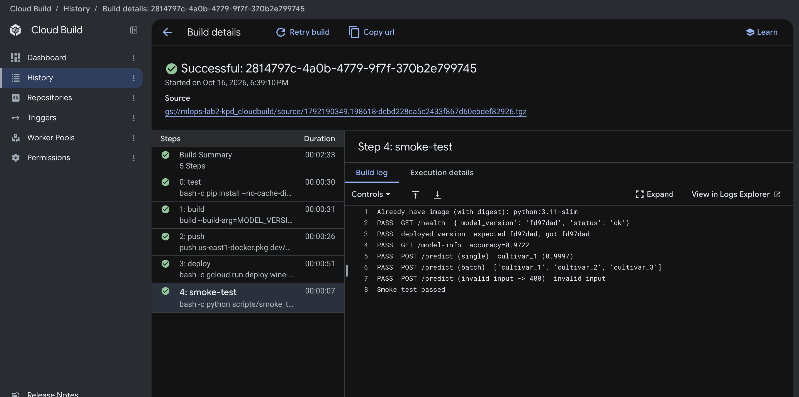
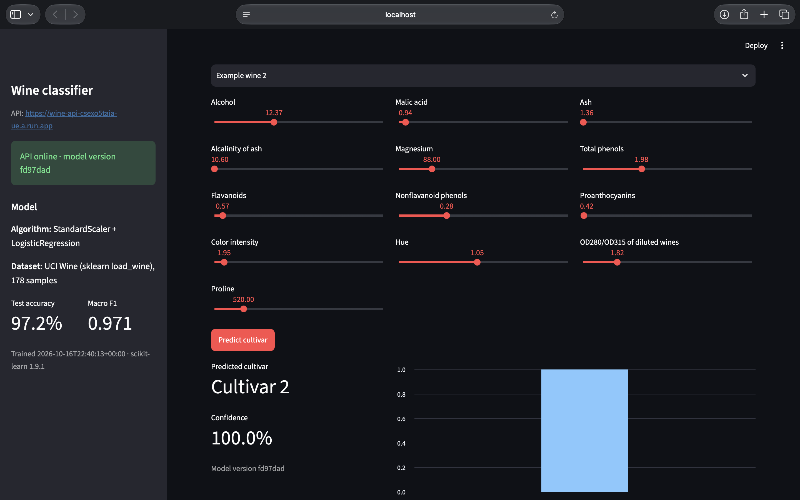
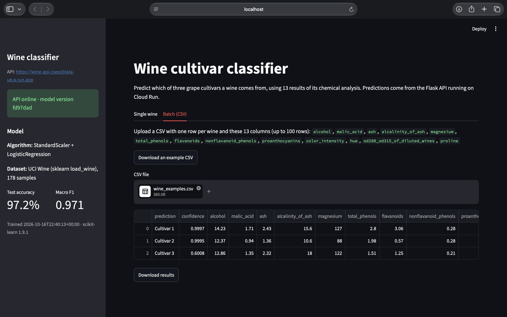

# MLOps Lab 2 - Flask API on Google Cloud Run

For this lab I used the course lab [API_Labs/FLASK_GCP_LAB](https://github.com/raminmohammadi/MLOps/tree/main/Labs/API_Labs/FLASK_GCP_LAB). In the original, a Flask API serves an Iris model, it gets built with Docker and deployed to Cloud Run with two commands, and a Streamlit app calls it.

I changed the API, the Docker setup and the way it's deployed to GCP. I also switched the dataset and model and rebuilt the dashboard. All my changes are listed in [What I changed](#what-i-changed).

**Live API:** https://wine-api-csexo5taia-ue.a.run.app (you can open `/health` or `/model-info` in the browser)

## Proof that it works

- The live API link above
- [Original lab vs. my baseline](https://github.com/KD7789/mlops-lab2-kpd/compare/original...baseline) (only the fixes I needed to run the original)
- [All my changes after that](https://github.com/KD7789/mlops-lab2-kpd/compare/baseline...main)

Deploying with one command (all 5 Cloud Build steps passed):



The dashboard:





Smoke test on the live service:

```
$ python scripts/smoke_test.py https://wine-api-csexo5taia-ue.a.run.app fd97dad
PASS  GET /health  {'model_version': 'fd97dad', 'status': 'ok'}
PASS  deployed version  expected fd97dad, got fd97dad
PASS  GET /model-info  accuracy=0.9722
PASS  POST /predict (single)  cultivar_1 (0.9997)
PASS  POST /predict (batch)  ['cultivar_1', 'cultivar_2', 'cultivar_3']
PASS  POST /predict (invalid input -> 400)  invalid input
Smoke test passed
```

## What I changed

I committed the original lab first without changes (tag `original`), then only the fixes needed to make it run (tag `baseline`, see the last part of this section), and then my own changes.

### The API (`src/main.py`, `src/predict.py`)

- `/predict` now takes one wine or a list of up to 100, and returns the predicted class, how confident the model is, and the probability of each class.
- Added input checks. Before, a missing or wrong field crashed the API with a 500 error. Now it returns a 400 error that lists what's wrong (missing fields, unknown fields, non-numbers, negative values).
- Added `/health` (is the service up, which model version) and `/model-info` (features, classes, accuracy, when it was trained).
- Turned off debug mode, replaced `print()` with logging, and errors now come back as JSON instead of HTML pages.

### Docker (`Dockerfile`, `gunicorn.conf.py`, `.dockerignore`)

- Switched to the slim Python image and only install what the API needs (Streamlit was inside the API image before). The image went from **2.82 GB to 604 MB**.
- The model is now trained while the image is built, instead of copying a `model.pkl` from git. This way it always matches the scikit-learn version in the image. If accuracy is below 0.90, **the build fails**, so a bad model can't be deployed.
- Replaced Flask's development server with gunicorn.
- Changed the start command so gunicorn runs directly as the main process. `docker stop` now takes 0.4 seconds instead of 3.3.
- The container runs as a normal user instead of root, and uses Cloud Run's `PORT` correctly (the original passed a Streamlit flag to a Flask app).
- Added a `.dockerignore` so things like `venv/` and the tests don't end up in the image.

### Deploying to GCP (`cloudbuild.yaml`)

- Before, deploying was two separate commands. Now one command runs 5 steps on Cloud Build: **run the tests, build the image, push it, deploy it, and test the live service**. If any step fails, the rest don't run.
- Images go to a normal Artifact Registry repository (`wine-api` in `us-east1`) instead of the old `gcr.io` path.
- Each image is tagged with its git commit, so I can see which code is running and go back to an older version.
- The service runs as its own service account with **no permissions**, since it doesn't need to access anything else in GCP. Before, it used the default account, which has access to most of the project.
- Cloud Build deploys using a separate account that only has the 5 permissions the deploy needs.
- Set limits: 512 MB memory, 1 CPU, 0 to 2 instances (so it costs nothing when nobody is using it). It uses port 8080 instead of 8501, which is Streamlit's port.
- The last step calls the live URL and checks that the new version is the one answering.

### Tests (`tests/test_api.py`, `scripts/smoke_test.py`)

- The original `test_api.py` was a script you ran by hand while the server was running. I replaced it with **13 pytest tests** that run without a server. They cover the endpoints, predictions, all the input errors and the accuracy check.
- `scripts/smoke_test.py` tests a running API, either local or on Cloud Run. Cloud Build runs it after every deploy.

### Dataset, model and dashboard

- Changed the dataset from Iris to **Wine** (178 wines, 13 chemical measurements, 3 grape cultivars).
- Changed the model from RandomForest to **scaling + logistic regression** in one pipeline. Test accuracy is 0.9722 and macro F1 is 0.9710.
- Training also saves `model_info.json`, which `/model-info` returns.
- Rebuilt the dashboard (`streamlit_app.py`):
  - The API URL can be changed with `API_URL` (it was hard-coded to the instructor's service).
  - The sidebar shows if the API is online, the model version and the accuracy.
  - Sliders for all 13 features, plus buttons to start from an average wine or one of 3 example wines.
  - Shows the predicted cultivar, the confidence and a chart of the probabilities.
  - A new tab to upload a CSV of up to 100 wines and download the predictions.
  - Removed the images that no longer loaded, and fixed the image-name bug and an outdated Streamlit setting.

### Fixes I needed to run the original lab (tag `baseline`)

- Changed the base image from Python 3.9 to 3.11 (3.9 is no longer supported, and the current scikit-learn doesn't install on it).
- Removed a duplicate line from `requirements.txt` and pinned the versions.
- Retrained the model with those versions.
- Pointed the Streamlit app at my own Cloud Run URL.

## Project files

```
src/train.py              trains the model, saves model/model.pkl and model/model_info.json
src/predict.py            loads the model and makes predictions
src/main.py               the Flask API
tests/test_api.py         pytest tests
scripts/smoke_test.py     checks a running API
samples/                  example requests
streamlit_app.py          dashboard
Dockerfile                builds the API image
gunicorn.conf.py          server settings
cloudbuild.yaml           the deploy pipeline
requirements*.txt         Python packages (API, tests, dashboard)
pytest.ini                pytest settings
.dockerignore             files kept out of the Docker image
.gcloudignore             files not uploaded to Cloud Build
.gitignore                files kept out of git (venv/, model/)
docs/                     screenshots used in this README
```

The `model/` folder isn't in git. `python src/train.py` creates it.

## What you need to install

| Tool | Version I used | Needed for |
|---|---|---|
| Git | any | everything |
| Python | 3.11 (3.11.4) | running locally |
| Docker Desktop | Docker 29.8.2 | running the container |
| Google Cloud CLI | 589.0.0 | deploying |
| A GCP project with billing | | deploying |

Links: [Python](https://www.python.org/downloads/), [Docker Desktop](https://www.docker.com/products/docker-desktop/), [Google Cloud CLI](https://cloud.google.com/sdk/docs/install)

The Python packages are pinned in the requirements files and get installed below:
- `requirements.txt`: flask 3.1.3, scikit-learn 1.9.1, numpy 2.4.6, joblib 1.6.0, gunicorn 26.2.0
- `requirements-dev.txt`: the same plus pytest 9.1.1
- `requirements-dashboard.txt`: streamlit 1.66.0, requests 2.34.2, pandas 3.0.6

I used macOS. On Windows, run the commands in WSL.

## Try the live API

No setup needed:

```bash
curl https://wine-api-csexo5taia-ue.a.run.app/health

curl -X POST https://wine-api-csexo5taia-ue.a.run.app/predict \
  -H "Content-Type: application/json" \
  -d '{"alcohol": 14.23, "malic_acid": 1.71, "ash": 2.43, "alcalinity_of_ash": 15.6, "magnesium": 127, "total_phenols": 2.8, "flavanoids": 3.06, "nonflavanoid_phenols": 0.28, "proanthocyanins": 2.29, "color_intensity": 5.64, "hue": 1.04, "od280_od315_of_diluted_wines": 3.92, "proline": 1065}'
```

You should get `"status":"ok"`, then `"prediction":"cultivar_1"`. The first request can take a few seconds because the service turns off when nobody is using it.

## Running it on your computer

1. Clone the repo and install the packages:

```bash
git clone https://github.com/KD7789/mlops-lab2-kpd.git
cd mlops-lab2-kpd
python3.11 -m venv venv
source venv/bin/activate
pip install -r requirements-dev.txt -r requirements-dashboard.txt
```

2. Run the tests. You should see `13 passed`:

```bash
pytest -v
```

3. Train the model. You should see `Test accuracy: 0.9722, macro F1: 0.9710`:

```bash
python src/train.py
```

4. Start the API and leave it running:

```bash
python src/main.py
```

5. In a second terminal (same folder, run `source venv/bin/activate` first):

```bash
curl -X POST localhost:8080/predict -H "Content-Type: application/json" -d @samples/batch.json
python scripts/smoke_test.py http://localhost:8080
```

The first command should return `cultivar_1`, `cultivar_2` and `cultivar_3`, and the smoke test should end with `Smoke test passed`.

6. Start the dashboard. Without `API_URL` it uses the live Cloud Run API instead of the local one:

```bash
API_URL=http://localhost:8080 streamlit run streamlit_app.py
```

## Running it in Docker

```bash
docker build -t wine-api:local .
docker run -d --rm --name wine-api -p 8080:8080 wine-api:local
python scripts/smoke_test.py http://localhost:8080 local
docker stop wine-api
```

You should see `Smoke test passed`, and `docker stop` should take less than a second.

To see the accuracy check stop a bad model, require 99.9% accuracy:

```bash
docker build --build-arg MIN_ACCURACY=0.999 -t wine-api:strict .
```

The build should fail with `Accuracy 0.9722 is below the required 0.999. Model not saved.`

## Deploying to your own GCP project

1. Log in, pick your project and turn on the services:

```bash
gcloud init
gcloud services enable cloudbuild.googleapis.com artifactregistry.googleapis.com run.googleapis.com
gcloud config set run/region us-east1
```

2. Create the image repository and the two service accounts (only once). Replace `your-project-id`:

```bash
PROJECT_ID=your-project-id
REGION=us-east1
DEPLOYER=wine-api-deployer@$PROJECT_ID.iam.gserviceaccount.com
RUNTIME=wine-api-runtime@$PROJECT_ID.iam.gserviceaccount.com

gcloud artifacts repositories create wine-api --repository-format=docker --location=$REGION
gcloud iam service-accounts create wine-api-runtime --display-name="Wine API runtime (no permissions)"
gcloud iam service-accounts create wine-api-deployer --display-name="Wine API Cloud Build deployer"

gcloud projects add-iam-policy-binding $PROJECT_ID --member=serviceAccount:$DEPLOYER --role=roles/logging.logWriter --condition=None --format=none
gcloud projects add-iam-policy-binding $PROJECT_ID --member=serviceAccount:$DEPLOYER --role=roles/run.admin --condition=None --format=none
gcloud artifacts repositories add-iam-policy-binding wine-api --location=$REGION --member=serviceAccount:$DEPLOYER --role=roles/artifactregistry.writer --format=none
gcloud iam service-accounts add-iam-policy-binding $RUNTIME --member=serviceAccount:$DEPLOYER --role=roles/iam.serviceAccountUser --format=none
gcloud storage buckets add-iam-policy-binding gs://${PROJECT_ID}_cloudbuild --member=serviceAccount:$DEPLOYER --role=roles/storage.objectViewer --format=none
```

If the last command says the `_cloudbuild` bucket doesn't exist, Cloud Build hasn't been used in that project yet. Run any `gcloud builds submit` once, then try again.

3. In `cloudbuild.yaml`, change `mlops-lab2-kpd` to your project ID on the `serviceAccount:` line (it's there twice).

4. Commit your code, then deploy (about 3 minutes):

```bash
gcloud builds submit --config cloudbuild.yaml --substitutions=_VERSION=$(git rev-parse --short HEAD)
```

It should finish with `STATUS: SUCCESS`.

5. Check the live service:

```bash
URL=$(gcloud run services describe wine-api --region us-east1 --format="value(status.url)")
python scripts/smoke_test.py $URL $(git rev-parse --short HEAD)
```

To go back to an older version, list the revisions and send all traffic to one of them:

```bash
gcloud run revisions list --service wine-api --region us-east1
gcloud run services update-traffic wine-api --region us-east1 --to-revisions=<REVISION_NAME>=100
```

## What a successful run looks like

- `pytest -v` shows `13 passed`
- `python src/train.py` shows `Test accuracy: 0.9722, macro F1: 0.9710`
- The smoke test prints only `PASS` lines and ends with `Smoke test passed`
- `gcloud builds submit` ends with `STATUS: SUCCESS`, and in the Cloud Build console all 5 steps are green
- In the dashboard, the sidebar says "API online", a prediction shows a cultivar with a chart, and the CSV tab gives one prediction per row

## Common problems

- **`command not found: gcloud`** right after installing: open a new terminal or run `source ~/.zshrc`.
- **Smoke test says `Connection refused`:** the API isn't running yet. Start it first.
- **`FileNotFoundError` for `model.pkl`:** run `python src/train.py` first.
- **Cloud Build permission error right after setup:** new permissions can take a minute or two. Wait and try again.
- **Build fails at the training step:** accuracy is below the limit. That's the check doing its job.
- **`400 invalid input`:** the `details` part of the response lists exactly which fields are wrong.

## Cleanup

Cloud Run scales to zero when nobody uses it, so it costs nothing while idle. To delete everything:

```bash
gcloud run services delete wine-api --region us-east1
gcloud artifacts repositories delete wine-api --location us-east1
gcloud iam service-accounts delete wine-api-deployer@<project-id>.iam.gserviceaccount.com
gcloud iam service-accounts delete wine-api-runtime@<project-id>.iam.gserviceaccount.com
```

## Credits

- Original lab: [raminmohammadi/MLOps, Labs/API_Labs/FLASK_GCP_LAB](https://github.com/raminmohammadi/MLOps/tree/main/Labs/API_Labs/FLASK_GCP_LAB)
- Dataset: Wine (UCI Machine Learning Repository), included in scikit-learn
